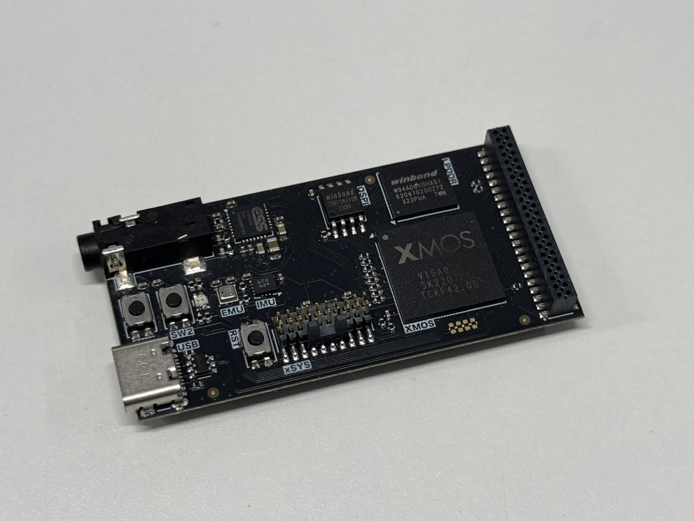
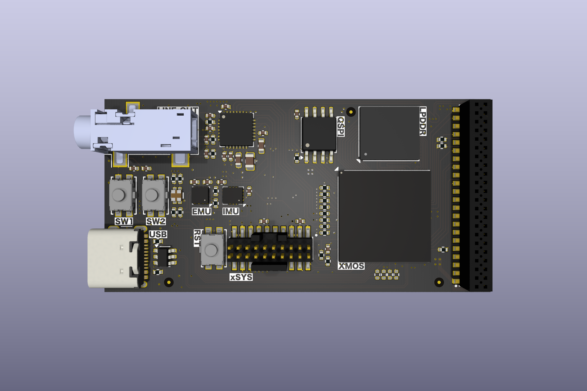
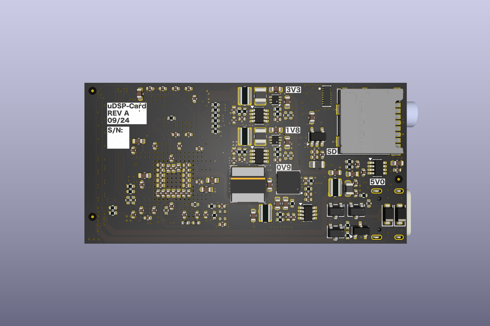

# uDSP-Card: XCORE.AI Development Board for Portable Applications

This repository contains the hardware design files, pinout, and architectural documentation for the uDSP-Card, a small development board built around the XMOS XU316. Originally designed for a wearable ultrasonic sensing system, the board offers rich I/O and high-performance DSP capabilities at low power, making it ideal for audio, sensing, and real-time embedded tasks.

This repository accompanies the blog post "[uDSP-Card: XCORE.AI Development Board for Portable Applications](https://crsknr.github.io/blog/blog/udsp-card)".

## Repository Contents

- `kicad_udsp-card/`: KiCAD project folder containing schematics and PCB layout  
- `uDSP-Card_HAD.pdf`: Hardware architecture design (HAD) documentation  
- `uDSP-Card_XMOS-XU316-pinout.xlsx`: Processor pin assignments

## Board Overview

The uDSP-Card is powered by the XMOS XU316, a dual-core, 800 MHz processor with 16 logical cores and a vector unit. The board is derived from the XMOS reference design and development board XK-EVK-XU316[^1].

### Key Specifications

- **Dimensions:** 60 mm × 30 mm (6-layer PCB)
- **Processor:** XMOS XU316-1024 (dual-core, 800 MHz, 16 threads)
- **RAM:** 128 Mb LPDDR1
- **Flash:** 32 Mb QSPI
- **microSD** card slot
- **USB Interface:** Device (power + audio/data)
- **Line Output:** Stereo via ESS ES9033 DAC
- **Expansion Header:** 44-pin interconnect
  - I²S (8ch)
  - I²C / SPI
  - PDM (8ch)
  - Power input
- **Onboard Sensors:**
  - BMI323 IMU (accelerometer + gyro)
  - BME280 EMU (humidity, pressure, temperature)

## Board support

[`lib_udsp-card_board_support`](https://github.com/crsknr/lib_udsp-card_board_support): XMOS board support package and configuration files for firmware development.

## Reference

[^1]: **XMOS**, *"xcore.ai Explorer v2 BoardManual"*, Manual XM014531A, (2024)

## License

This project is licensed under the [GNU General Public License v3.0](https://www.gnu.org/licenses/gpl-3.0.en.html).
